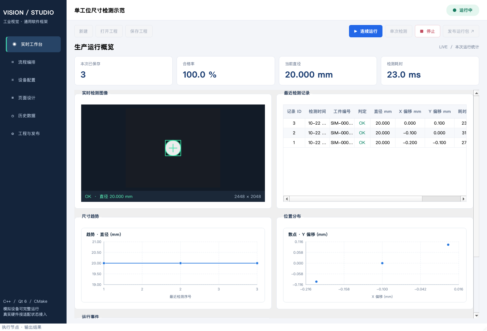
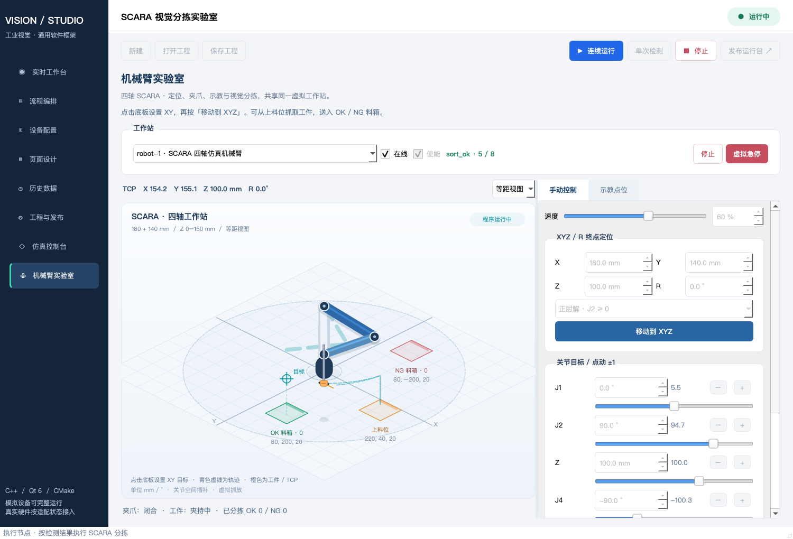

# Industrial Vision Studio / 工业视觉通用框架

C++17、Qt 6.5+、CMake 的完整桌面项目。默认无商业SDK依赖，可直接运行有状态虚拟硬件与仿真控制台、真实图像测量、结果判定、SQLite存储、可视化顺序流程、可配置数据显示页及当前平台运行包发布。

## 项目入口与界面

- 源码仓库：[xin-zai-dev / SoftwareFramework](https://github.com/xin-zai-dev/SoftwareFramework)
- 个人作品集：[xin-zai-dev.github.io](https://xin-zai-dev.github.io/#work)

这是需要本机 Qt 环境编译运行的桌面软件；个人网站提供项目介绍与截图。以下截图使用模拟设备和示范工程。源码仓库不包含 Qt 运行库、商业 SDK、本机检测数据库或已打包应用。

### 检测工作台



### SCARA 机械臂实验室



## 在 Qt Creator 打开

1. 打开本文件夹下的 **CMakeLists.txt**。
2. 选择 Qt 6 Desktop Kit；本机已验证环境为 **Qt 6.11.2 / macOS arm64**。
3. 点击配置、构建和运行，目标为 **IndustrialVisionStudio**。
4. 在“实时工作台”点击“连续运行”或“单次检测”。默认每秒1件，每第5件产生可通过真实图像算法测出的超差直径。

Windows 请选择匹配的 **Qt 6 + MSVC x64** Kit；CMake 工程可跨平台，Windows构建与厂商驱动需要Windows环境另行验证。无需安装OpenCV/HALCON/相机SDK即可构建默认配置。

## 命令行构建

当前 Mac：

```sh
cmake --preset macos-local
cmake --build --preset macos-local --parallel 4
ctest --test-dir build/macos --output-on-failure
./build/macos/IndustrialVisionStudio.app/Contents/MacOS/IndustrialVisionStudio
```

其他安装路径（在已配置编译器的终端执行，Qt Creator 也可自动提供这些参数）：

```sh
cmake -S . -B build/local -DCMAKE_PREFIX_PATH="<Qt6安装目录/平台套件>" -DCMAKE_BUILD_TYPE=Release
cmake --build build/local --config Release --parallel 4
ctest --test-dir build/local -C Release --output-on-failure
```

若终端未配置 Ninja，可使用系统默认生成器，或指定 Qt 随附的 Ninja。`macos-local` preset只用于这台Mac，其他机器使用自己的Kit或路径。

## 使用流程

- **流程编排**：从节点库拖入/双击添加节点，拖动重排，修改节点参数JSON并点“应用参数”。当前为顺序执行器，非任意图调度。必要链路是采集→测量→判定→保存，输出在保存后执行。
- **设备配置**：默认5种模拟设备。真实Modbus TCP PLC/I/O可配置host、port、unitId及节点寄存器映射；厂商型号目录会显示实际支持状态，不能把模拟演示当作实机适配。
- **仿真控制台**：四轴使能、点动、定位、回零和停止；四通道光源开关/亮度；PLC/I/O 的数字信号、寄存器、手动触发与断线/虚拟急停。控制台与运行流程共享状态，位置和亮度会影响图像，结果输出写回信号表。勾选“手动接管”可保留手调位置和亮度。
- **机械臂实验室**：四轴SCARA动画、关节与XYZ/R定位、夹爪抓放、轨迹、示教记录/文件/回放，以及按视觉OK/NG结果自动分拣。Mac可双击“启动机械臂仿真.command”，操作见 [机械臂说明](docs/robot-simulation.md)。
- **页面设计**：增删和重排图像、表格、曲线、散点和日志面板，绑定直径、偏移或耗时字段。保存后工程包含布局和绑定。
- **工程与发布**：设置分辨率、节拍、标定、阈值、数据库、图像策略。采集分辨率不会自动提升物理精度。当前算法对暗背景单个亮色工件计算阈值包围框直径，生产使用前需真实样本与标定验证。
- **历史数据**：每页100条游标查询，支持工件精确编号、结果、时间筛选及完整CSV导出；双击记录查看保留图像。
- **百万条验证**：按钮创建独立`data/benchmark.sqlite`，不往检测库写测试数据。界面不将百万条一次加载到内存。
- **发布运行包**：选择目录，生成独立子目录；收集当前平台Qt依赖并保存工程，客户无需Qt Creator。发布不复制原始检测数据库和图像。

## 工程结构与数据位置

- `src/domain`：类型、工程校验/JSON、图像测量。
- `src/application`：工作线程顺序执行器、发布器。
- `src/infrastructure`：SQLite/QODBC仓库、模拟设备、真实Modbus TCP、厂商SDK扩展入口。
- `src/ui`：主窗口、Model/View表格、拖拽编辑器、自绘曲线/散点、图像叠加。
- `examples`：可重开并发布的示范工程。
- `tests`：真实临时SQLite、图像测量、流程取消/异常、协议回环及编辑器测试。
- `tools`：百万条数据生成和查询基准工具。
- `data`：默认检测库、独立基准库、受管理图像与日志（运行时生成）。
- `reports` / `verification`：本次验证结果与截图。
- `build`：本地构建与隔离模块测试。

开发时工作目录默认是源工程目录，全部相关文件在本文件夹；可用`--workspace <目录>`显式选择。发布后从运行包同级的`project.ivproj`自动识别客户模式，数据写在运行包目录，请放在可写位置。

## 验证与独立工具

```sh
./build/macos/ivs_data_tool --database data/benchmark.sqlite --seed 1000000 --report reports/million-records.json
./build/macos/IndustrialVisionStudio.app/Contents/MacOS/IndustrialVisionStudio --smoke-test --workspace verification/smoke --cycles 6
./build/macos/IndustrialVisionStudio.app/Contents/MacOS/IndustrialVisionStudio --publish-to publish/VisionRuntime
```

命令行`--seed`是**追加指定数量**；GUI按钮是**补齐至100万**。不要反复对同一测试库追加而误判容量。`--smoke-test`只在指定workspace使用独立SQLite；为保护服务器数据，它不会使用SQLServer后端。

## 可选视觉SDK

- OpenCV：`-DIVS_WITH_OPENCV=ON -DOpenCV_DIR=<OpenCVConfig.cmake目录>`，启用OpenCV阈值/几何测量；默认原生Qt C++实现等价的示范路径。
- HALCON：`-DIVS_WITH_HALCON=ON -DHALCON_ROOT=<安装目录> -DHALCON_ARCH=<目标架构>`，链接SDK并提供后续算法扩展入口；**本版没有HALCON算子流程节点或HDevelop解释器**，不内含任何授权或运行库。
- MVS：`-DIVS_WITH_MVS=ON -DIVS_MVS_ROOT=<安装目录>`仅校验和链接SDK扩展钩子；**本版未实现厂商相机采集适配**，真实`mvs`配置仍明确拒绝。Baumer、固高、雷赛及OPT/CCS专有协议也仍待厂商SDK与实机适配，不能仅因为列出型号就宣称已支持。

SQLite和通用Modbus TCP已有实现和测试；SQL Server有QODBC实现，但需要实际服务、ODBC驱动和凭据进行验收。协议回环测试需要操作系统允许本机监听端口。

## 生产边界

这是可运行、可扩展的首版框架，不是经产线认证的控制系统。确定性运动、位置触发、急停与安全联锁由合适控制器实现；软件停止不代替硬件急停。运行页为本次运行统计；历史库保留全部已确认记录。停止会取消后续步骤，不自动重发运动/分拣动作。

Qt及任何启用的第三方库的发布条款需按实际所用版本与分发方式核对。未经验证的商业SDK运行库不自动随运行包分发。

详细说明：`docs/design.md`、`docs/hardware.md`、`docs/storage.md`、`docs/runtime.md`、`docs/publishing.md`。

## 无硬件联调

Mac 可双击 **启动无硬件仿真.command**；Qt Creator 的运行参数可填：

```text
--project <本工程绝对路径>/examples/simulation-only.ivproj --workspace <本工程绝对路径>/simulation-lab --simulation-console
```

启动后在“仿真控制台”关闭自动触发，点击“单次检测”，再点“触发一件”。检测完成后在 I/O 信号表中查看 holding 地址0：1=OK、2=NG。切换工件场景可直接验证合格、超差或缺件；勾选手动接管后再调整位置和光源，可测试偏移和无光故障。输入/输出地址均从0开始，寄存器共64个，数字信号各16个。

完整操作示例和仿真边界见 [仿真控制台使用说明](docs/simulation-console.md)。
